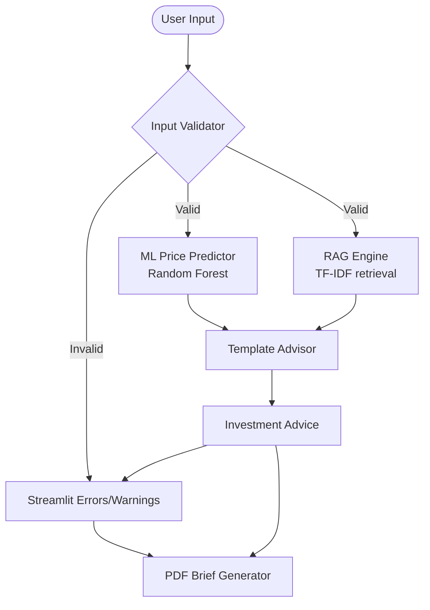

# Intelligent Property Valuation Agentic Advisor 🏠

A real estate research prototype combining Random Forest valuation, deterministic TF-IDF retrieval, comparable-sales evidence, and a rule-based investment summary. The Streamlit workspace supports reusable property profiles and downloadable PDF briefs without an API key.

## 🔗 Live Demo
**Access the application on Streamlit Cloud:** [Live Demo](https://property-valuation-agentic-advisor-xvfy6pzq5caq72fmxlzrak.streamlit.app/)

> [!NOTE]
> The hosted app is fully deployed and healthy, but anonymous public access to the root URL depends on the current Streamlit Cloud visibility settings. If you encounter an authentication screen, the backend/model remains fully verifiable via the `/healthz` health endpoint.

## 🎯 Project Overview
The core objective is to estimate property value from historical housing data and then explain that estimate with grounded, retrieval-backed investment advice.

## 📐 System Architecture
The system follows a **deterministic workflow** where ML predictions are enriched by a local knowledge base (retrieval) and summarized by a template-based advisor (no LLM dependencies).



### Core Components
- **Deterministic Brain (ML)**: A Random Forest model trained on historical housing data to provide baseline valuations.
- **Contextual Memory (RAG)**: A lightweight retrieval index over the local knowledge base that surfaces market trends and relevant notes.
- **Advisory Layer**: A template-based advisor that combines the ML estimate, retrieved context, and comparable sales.
- **Presentation Layer**: A professional Streamlit UI with PDF export capabilities for institutional-grade briefs.

## 🎯 Demo Guidance

### 1. The "Happy Path" (Standard Valuation)
- **Inputs**: Choose **Family home** in the sidebar or enter your own property details.
- **Action**: Click **Estimate value** to view the estimate and value per square foot.
- **Evidence**: Open **Comparable evidence** for the sales table and price comparison chart.
- **Export**: Open **Export report** and select **Download PDF brief**.

### 2. The "Guardrail Path" (Outlier Detection)
- **Inputs**: 5000 sq ft, 1 Bedroom.
- **Expectation**: The `validator.py` will trigger a **Soft Warning** (Unusual area for bedrooms).
- **Benefit**: Demonstrates the system's ability to prevent "Garbage In, Garbage Out" scenarios.

### 3. The "Deterministic Path" (No API Key Needed)
- **Action**: Run the app without any LLM/API keys.
- **Expectation**: The app always generates an advisory summary using deterministic retrieval + simple decision rules.

## 📊 Model & Metrics
The model is trained on the [Kaggle Housing dataset](https://www.kaggle.com/datasets/yasserh/housing-prices-dataset). The committed metadata records 545 rows, with 436 training rows and 109 test rows.

| Metric | Random Forest | Linear Regression |
| :--- | :--- | :--- |
| **R² Score** | 0.592 | 0.627 |
| **MAE** | ₹1,065,347 | ₹999,836 |

> [!NOTE]
> While Linear Regression has a slightly higher R², Random Forest is chosen for the production "Advisor" path for its ability to capture non-linear feature interactions and provide **Feature Importance** insights.

## 🛠️ Installation & Setup

### Local Setup
```bash
git clone https://github.com/Subham-KRLX/property-valuation-agentic-advisor.git
cd property-valuation-agentic-advisor
python3 -m venv venv
source venv/bin/activate
pip install -r requirements.txt
pip install -r requirements-dev.txt 
```

### 2. Train the Model Locally
If `models/house_model.pkl` is missing, train the model:
```bash
python3 src/train_model.py
```
For the hosted Streamlit demo, a pre-trained `models/house_model.pkl` is included in the repo to avoid retraining during deployment.

### 3. Run the App
```bash
streamlit run app.py
```

### Environment Configuration
| Variable | Description |
| :--- | :--- |
| `KAGGLE_USERNAME` | Required if retraining the model from source. |

### Running Tests
```bash
python3 -m pytest tests/
```

## 🌐 Deployment Status
The project maintains a healthy deployment on Streamlit Cloud. You can verify the operational status of the hosted app even if the root URL is set to private/authenticated:

- **Health Check**: [Verify Health Endpoint](https://property-valuation-agentic-advisor-xvfy6pzq5caq72fmxlzrak.streamlit.app/healthz)
  - Should return: `{"status":"ok"}`
- **Automated Smoke Check**:
  Verify deployment health and accessibility locally:
  ```bash
  bash scripts/check_streamlit_deployment.sh
  ```

## 🛡️ Robustness & Fallbacks
- **No API key required**: Valuation and advisory use the committed model and local TF-IDF retrieval.
- **Advisory failure**: The valuation remains visible if retrieval or advisory fails.
- **Missing retrieval index**: The app rebuilds the local index from knowledge-base documents.
- **Input guardrails**: Unusual property combinations show warnings alongside the result.

## Interview Demo

1. Select a sample property and run the valuation.
2. Explain the estimate and input guardrails, then inspect comparable evidence.
3. Open **Model evidence** to discuss held-out metrics, feature importance, and benchmark tradeoffs.
4. Export a PDF brief. Change profiles or reset to demonstrate the state flow.

The model does not use location as an input. The knowledge base is static and Bangalore-focused; it is not a live market feed. Global feature importance is not a per-property explanation, and test error is not an individual confidence interval.

## 📂 Project Structure
- `src/app.py`: Streamlit frontend.
- `src/dashboard.py`: Workspace styling, presets, charts, and evidence presentation.
- `.streamlit/config.toml`: Native light theme.
- `src/agent.py`: Template-based advisor (no LLM dependencies).
- `src/rag_engine.py`: Knowledge-base retrieval + comparable-sales matcher.
- `src/train_model.py`: ML pipeline (download -> preprocess -> tuning -> evaluation).
- `src/validator.py`: Input guardrails.
- `src/pdf_report.py`: Automated PDF reporting via ReportLab.

## 🛡️ Limitations & Roadmap
- **Current**: Static knowledge base in `comparable_sales.txt`.
- **Roadmap**: 
  - [ ] **Live Market Data**: Integration with real estate APIs for real-time comps.
  - [ ] **Interactive Maps**: Geographic visualization of target property vs. retrieved comps.
  - [ ] **Deep Learning**: Experimenting with XGBoost or Neural Networks for improved R².

## 👥 Team
- **Nss Gourav**
- **Subham Sangwan**

---
*Developed for Project 9: Intelligent Property Price Prediction.*
